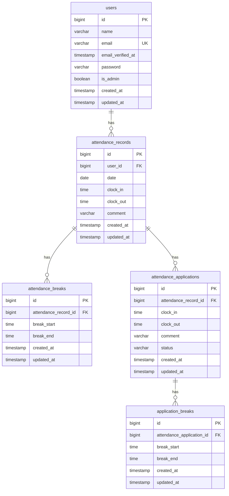

# 勤怠管理アプリ

## 概要

ユーザーの出退勤時刻や休憩時間を管理する勤怠管理アプリです。

一般ユーザーは日々の勤怠登録や修正申請を行うことができ、管理者はユーザーの勤怠情報の確認や修正申請の承認を行うことができます。

## ER図



## 主な機能

### 一般ユーザー

- ユーザー登録・ログイン
- メール認証
- 出勤・退勤時刻の登録
- 休憩開始・終了時刻の登録
- 勤怠一覧の確認
- 勤怠詳細の確認
- 勤怠情報の修正申請
- 修正申請一覧の確認

### 管理者

- 管理者ログイン
- 全ユーザーの勤怠一覧の確認
- 日付別勤怠一覧の確認
- ユーザー一覧の確認
- ユーザーごとの月別勤怠一覧の確認
- 勤怠情報の修正
- 修正申請一覧の確認（承認待ち・承認済み）
- 勤怠修正申請の承認

## 環境構築手順

### 1. リポジトリのクローン

```bash
git clone https://github.com/mayu-boshu/COACHTECH-attendance-app.git
cd COACHTECH-attendance-app
```

### 2. 環境設定ファイルの作成

```bash
cp .env.example .env
```

`.env` を開き、以下の内容に設定します。

```env
APP_NAME=Attendance
APP_URL=http://localhost

DB_CONNECTION=mysql
DB_HOST=mysql
DB_PORT=3306
DB_DATABASE=laravel
DB_USERNAME=sail
DB_PASSWORD=password

MAIL_MAILER=smtp
MAIL_HOST=mailpit
MAIL_PORT=1025
```

※その他の設定は必要に応じて変更してください。

### 3. Composerパッケージのインストール

Dockerを使用してComposerを実行します。

```bash
docker run --rm \
  -u "$(id -u):$(id -g)" \
  -v "$(pwd):/app" \
  -w /app \
  composer:2 \
  composer install
```

### 4. Dockerコンテナの起動

```bash
./vendor/bin/sail up -d
```

### 5. アプリケーションキーの生成

```bash
./vendor/bin/sail artisan key:generate
```

### 6. データベースのマイグレーション・テストデータの作成

```bash
./vendor/bin/sail artisan migrate
./vendor/bin/sail artisan db:seed --class=AttendanceDemoSeeder
```

### 7. フロントエンドのパッケージインストール

```bash
./vendor/bin/sail npm install
```

### 8. Viteの起動

```bash
./vendor/bin/sail npm run dev
```

## テストアカウント

| 権限         | メールアドレス    | パスワード |
| ------------ | ----------------- | ---------- |
| 一般ユーザー | user1@example.com | password   |
| 管理者       | user3@example.com | password   |

※テストアカウントは `AttendanceDemoSeeder` によって作成されます。

## 使用技術

| 技術         | バージョン         |
| ------------ | ------------------ |
| PHP          | 8.5.8              |
| Laravel      | 10.50.3            |
| MySQL        | 8.4                |
| Vite         | 5系                |
| Axios        | 1.6系              |
| Docker       | 29.4.1（開発環境） |
| Laravel Sail | Docker環境構築     |
| phpMyAdmin   | latest             |
| Mailpit      | latest             |
| HTML / CSS   | -                  |

## 開発環境URL

| サービス             | URL                          |
| -------------------- | ---------------------------- |
| アプリケーション     | http://localhost             |
| 一般ユーザーログイン | http://localhost/login       |
| 管理者ログイン       | http://localhost/admin/login |
| phpMyAdmin           | http://localhost:8080        |
| Mailpit              | http://localhost:8025        |

## 作成者

房州 真優
